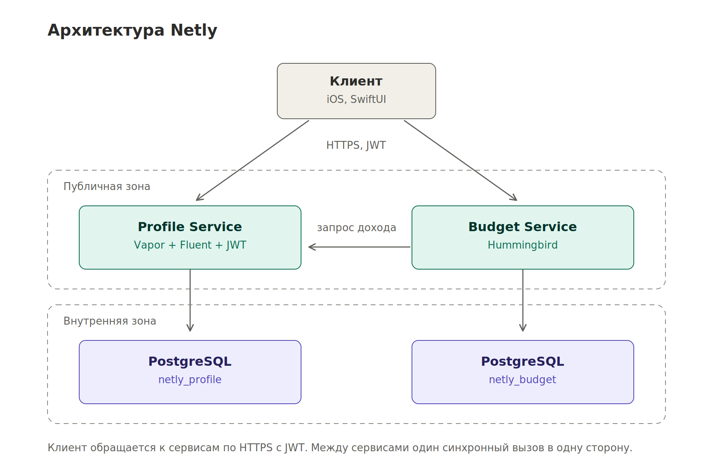
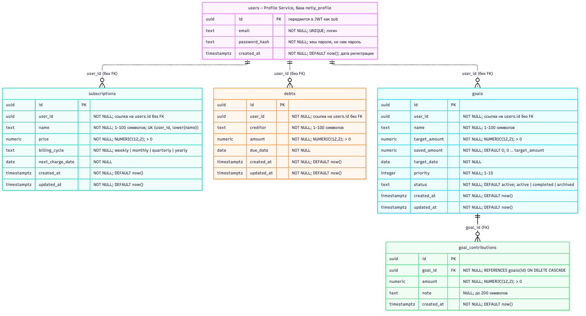

# Netly

## Domain

Personal finance: tracking income, mandatory expenses, subscriptions, debts, actual spending and savings goals. The app converts income of different periodicity into a monthly equivalent, computes the free balance and distributes it across goals by priority.

On top of the budget plan, Netly shows the user's route for the day on a map together with the amount spent at each place.

The client is an iOS app built with SwiftUI. The backend consists of three independent microservices written in Swift.

The business problem, user stories with acceptance criteria and the decomposition into microservices: [`docs/requirements.md`](docs/requirements.md).

## Architecture



> The diagram currently shows Profile Service and Budget Service. `spending-service` is described below and will be added to the diagram along with its implementation.

The client talks to all three services directly over HTTPS. Authentication is based on JWT: the token is issued by Profile Service, while Budget Service and Spending Service verify its signature with a shared secret. The token is signed with HS256, carries the user id in `sub` and an expiry in `exp`; the shared `JWT_SECRET` must be at least 32 bytes long, and Budget Service refuses to start otherwise. The databases live on the internal network and are not reachable from outside.

The system contains a single synchronous call, in one direction only: Budget Service asks Profile Service for the monthly income and mandatory expenses. There are no reverse calls and no cycles.

Spending Service neither calls other services nor is called by them, and location data never leaves its own database.

| Service            | Responsibility                                                          | Port |
| ------------------ | ----------------------------------------------------------------------- | ---- |
| `profile-service`  | Authentication, onboarding, income sources, mandatory expenses          | 8081 |
| `budget-service`   | Subscriptions, debts, goals, free-balance calculation                   | 8082 |
| `spending-service` | Actual spending, route, matching purchases to places, daily map         | 8083 |

## Daily Spending Map (planned)

### What the user sees

- The route line for the day.
- Pins at the places where money was spent; the pin size is proportional to the amount.
- Tapping a pin shows the merchant, the time and the amount.
- A daily total broken down by category.

### Where the spending data comes from

- **Apple Pay.** A Shortcuts automation (the `Transaction` trigger, `Wallet` on newer iOS versions) invokes the `Add Expense` App Intent and passes the amount and the merchant name; the app records the time. Third-party apps have no direct access to Apple Pay history: FinanceKit is available only in the United States and the United Kingdom.
- **Manual entry.** For QR payments, transfers, cash and plastic-card payments.

### Matching a purchase to a place

The server looks for the visit during which the purchase was made. If there is no such visit, it takes the nearest route point in time within a 15-minute window. The match is not stored but computed when the day is requested, so it also works when a visit reaches the server later than the purchase.

## Telematics Component

| Link                | Implementation                                                                                                    |
| ------------------- | ----------------------------------------------------------------------------------------------------------------- |
| Moving object       | The user's smartphone                                                                                             |
| Positioning         | GNSS receiver (GPS, GLONASS) via CoreLocation                                                                      |
| Events              | Visits, significant location changes, NFC payment events through the Wallet automation                             |
| Communication link  | Cellular network or Wi-Fi over HTTPS; while offline, data is buffered in SwiftData and sent as a batch             |
| Processing          | Spending Service matches purchases to the route                                                                    |
| Output              | The daily spending map                                                                                             |

Continuous GPS tracking is not used: the route is reconstructed from visits and significant location changes in order to save battery.

## Technology Stack

| Component        | Technology                                   | Language | Storage    |
| ---------------- | -------------------------------------------- | -------- | ---------- |
| Client           | SwiftUI, iOS 17+, MapKit, CoreLocation, App Intents | Swift | SwiftData  |
| Profile Service  | Vapor, Fluent, JWT                           | Swift    | PostgreSQL |
| Budget Service   | Hummingbird, PostgresNIO, postgres-migrations | Swift   | PostgreSQL |
| Spending Service | Hummingbird, PostgresNIO                     | Swift    | PostgreSQL |
| Runtime          | Docker, Docker Compose                       | —        | —          |

The framework choice for each service is justified in [`docs/requirements.md`](docs/requirements.md). In short: Profile Service works with a connected relational model and is responsible for authentication, so it uses the full-featured Vapor with its ORM and JWT module. Budget Service has a flat data model and a mostly computational workload, so it uses the minimalistic Hummingbird with the PostgresNIO driver directly. This is the same contrast as Django versus Flask in the Python ecosystem.

Spending Service uses the same stack as Budget Service: its data model is flat (two tables), coordinates are stored as ordinary columns, and matching by time is done with ordinary SQL — PostGIS and a heavyweight ORM are not needed here.

## Getting Started

Current state: Profile Service registers users, stores bcrypt password hashes in PostgreSQL, issues 15-minute JWTs with a `user` or `admin` role and guards an admin-only route. Budget Service serves a JWT-protected CRUD API for subscriptions, debts and savings goals, plus goal contributions recorded in a transaction. Data lives in PostgreSQL behind a repository layer, the schema is managed by migrations, monthly equivalents are computed on read, and every error of both services has the same `{"error": {"code", "message", "details"}}` body. The API contracts are [`docs/api/profile-service.openapi.yaml`](docs/api/profile-service.openapi.yaml) and [`docs/api/budget-service.openapi.yaml`](docs/api/budget-service.openapi.yaml); validation rules, the error format and a request/response example for every operation are in [`docs/api/budget-service.md`](docs/api/budget-service.md). Spending Service is designed; its implementation is planned.

Requires Swift 6.2 or newer (Budget Service depends on Hummingbird 2, which needs Swift tools 6.2), or Docker. The Swift 6.4 toolchain from the Xcode beta cannot build the `swift-collections` 1.7.0 dependency yet; use Docker with it.

### All services via Docker

```bash
docker compose up --build
```

Set `JWT_SECRET` (at least 32 bytes) to override the development secret used by default. Every setting is listed in [`.env.example`](.env.example); copy it to `.env` to change them, and docker compose picks the file up.

This brings up the `profile`, `budget` and `postgres` containers, with `postgres` hosting two databases (`netly_profile` and `netly_budget`). Before each service starts, its one-shot `profile-migrate` or `budget-migrate` container applies pending database migrations.

A `pgdata` volume created before migrations were introduced already holds tables without a migration history; reset it once with `docker compose down -v`.

Once Spending Service is implemented, a `spending` container and a `netly_spending` database in the same PostgreSQL instance will be added.

### A single service

```bash
cd services/profile-service
swift run
```

Budget Service needs PostgreSQL, configured only through the `DB_*` environment variables:

```bash
docker compose up -d postgres
cp .env.example .env                  # once
cd services/budget-service
set -a && . ../../.env && set +a
swift run App migrate                 # creates or updates the schema
swift run App                         # serves on :8082; logs the database it connected to
```

### Tests

See [Testing](#testing) below.

### API contract

Check the OpenAPI contract with [Redocly CLI](https://redocly.com/docs/cli/):

```bash
npx @redocly/cli lint docs/api/budget-service.openapi.yaml docs/api/profile-service.openapi.yaml
```

The contract is valid. The three remaining warnings are expected: no license, a `localhost` server URL, and no `4xx` response on `/health`.

### Database

Budget Service keeps its data in the `netly_budget` PostgreSQL database: `subscriptions`, `debts`, `goals` and `goal_contributions`, with `goals` 1:N `goal_contributions` through a foreign key. Every table carries the owner's `user_id`, a logical reference to `users` in Profile Service's own `netly_profile` database: it comes from the signed JWT, and there is no foreign key across databases.



- [`docs/database.md`](docs/database.md): the ER diagram, every table and constraint, the index rationale, the migrations and the transactional scenario.
- [`docs/verification.md`](docs/verification.md): real requests and responses against PostgreSQL, the migration rollback, the rolled-back transaction in the PostgreSQL log, and identical data after the containers are recreated.

The schema is created only by migrations:

```bash
docker compose run --rm budget-migrate     # apply pending migrations
docker compose run --rm budget rollback    # revert the newest migration
```

The server refuses to start while the schema is behind the code.

### Authentication and roles

Profile Service owns accounts. A password is stored only as a bcrypt hash (cost 12); login returns an HS256 JWT with `sub` (user id), `role` and a 15-minute `exp`, which Budget Service verifies with the shared `JWT_SECRET`.

| Operation                                   | Guest | `user` | `admin` |
| ------------------------------------------- | ----- | ------ | ------- |
| `POST /auth/register`, `POST /auth/login`   | yes   | yes    | yes     |
| `GET /users/me`                             | 401   | yes    | yes     |
| CRUD on one's own budget records            | 401   | yes    | yes     |
| Another user's budget record                | 401   | 404    | 404     |
| `GET /admin/users`                          | 401   | 403    | yes     |

Every account registers as `user`; a `role` in the request body is ignored. Grant `admin` with `docker compose run --rm profile make-admin <email>`. Details: [`services/profile-service/README.md`](services/profile-service/README.md). The three access scenarios (no token, `user`, `admin`) are checked against the running services in [`docs/auth-check.md`](docs/auth-check.md).

#### Why JWT and not a server-side session

- **No shared session store.** Budget Service checks the signature and expiry itself, with the shared `JWT_SECRET`. A session would need a store that both services query on every request (Redis or a table in Profile Service's database), which adds a component and a network hop, and breaks the rule that each service reads only its own database.
- **No cookies, no CSRF.** The client is an iOS app that sends `Authorization: Bearer`; there is no browser cookie for a cross-site request to ride on.
- **The role travels with the token.** `RoleGuard` decides `403` from the `role` claim without a database query.
- **The cost is revocation.** A JWT cannot be withdrawn before `exp`, while a session can be deleted at once. The token therefore lives 15 minutes; refresh tokens with revocation are planned.

#### Error format

Every error of both services, from validation to an unexpected exception, has one body and the matching HTTP status:

```json
{ "error": { "code": "forbidden", "message": "Requires the admin role", "details": [] } }
```

`code` is machine-readable, `message` is for people, and `details` lists every invalid field of a `validation_failed` error (empty otherwise). The full list of codes is in [`docs/api/budget-service.md`](docs/api/budget-service.md#error-format).

### Calling the API

```bash
curl -X POST http://localhost:8081/api/v1/auth/register -H "Content-Type: application/json" \
  -d '{"email": "alibek@netly.kz", "password": "correct horse"}'
TOKEN=$(curl -s -X POST http://localhost:8081/api/v1/auth/login -H "Content-Type: application/json" \
  -d '{"email": "alibek@netly.kz", "password": "correct horse"}' | jq -r .accessToken)

curl -X POST http://localhost:8082/api/v1/subscriptions \
  -H "Authorization: Bearer $TOKEN" -H "Content-Type: application/json" \
  -d '{"name": "Netflix", "price": 119.88, "billingCycle": "yearly", "nextChargeDate": "2026-12-15"}'
curl "http://localhost:8082/api/v1/goals?status=active" -H "Authorization: Bearer $TOKEN"
```

[`scripts/demo-auth.sh`](scripts/demo-auth.sh) runs the whole flow and shows `201`, `200`, `401`, `403`, `404` and `422`. For Budget Service alone, `scripts/dev-token.sh` mints a token without Profile Service.

### Health check

```bash
curl http://localhost:8081/health
curl http://localhost:8082/health
```

Response:

```json
{ "status": "ok", "service": "netly-profile" }
```

## Testing

One command runs both services' tests in the `swift:6.2-noble` image against PostgreSQL and writes a coverage report:

```bash
./scripts/test.sh            # both services
./scripts/test.sh profile    # one service: profile or budget
```

The script starts the compose `postgres` container, recreates the empty `netly_profile_test` and `netly_budget_test` databases, so every run starts from the same state and applies all migrations, runs `swift test --enable-code-coverage` and converts the result with `llvm-cov`. Reports land in `coverage/` (git-ignored): `coverage/<service>-service.txt` with per-file numbers and `coverage/<service>-service/index.html` to browse line by line.

Without Docker networking, `swift test` inside a service directory runs every test that needs no database; the database suites are skipped.

### What the tests cover

| Kind | Profile Service | Budget Service |
| ---- | --------------- | -------------- |
| Unit, no network or database | 13 | 20 |
| API through the framework's test client | 11 | 37 |
| API and repositories against PostgreSQL | 6 | 9 |
| Total | 30 | 66 |

Unit tests cover the business rules: email normalization and format, the 15-minute token, the rate limiter window, money and text validation, the savings-goal rules (saved amount within the target, a past target date checked only when it changes, priority 1 to 10), the monthly equivalents and partial updates. API tests pair a success with a failure for every operation: registration, login, roles, CRUD of each budget resource, goal contributions, a missing, forged or expired token on every protected route, and the error format.

### Isolation

- Database suites run only when `DB_NAME` ends in `_test`, so a run pointed at `netly_profile` or `netly_budget` skips them instead of wiping working data.
- Every database test starts from empty tables: Profile Service truncates `users`, Budget Service truncates its four tables after applying migrations.
- Each test creates its own application and in-memory state, and budget tests sign tokens for fresh random users, so no test depends on another's data or order. Database suites are `.serialized` because they share the tables; the rest run in parallel.

### Coverage

Measured on 2026-11-10 with `./scripts/test.sh` (all 96 tests passing, database suites included; a repeated run gives the same numbers):

| Service | Lines | Functions | Regions |
| ------- | ----- | --------- | ------- |
| Profile Service | 87.6% (368 of 420) | 83.6% | 77.8% |
| Budget Service | 91.7% (1200 of 1309) | 89.0% | 84.7% |

Where coverage is low, and why:

- **Entry points: 0%.** `Entrypoint.swift` (Profile) and `App.swift` (Budget) parse the command line and start the server; tests build the application directly. They are exercised every time `docker compose up` starts the services.
- **`MakeAdminCommand.swift`: 0%.** The console command that grants `admin` is checked by hand (`docs/auth-check.md`); the role check it enables is tested through `adminListsUsersAfterPromotion`.
- **`CreateUsers.swift`: 83%.** The migration is applied to the freshly created test database, but its `revert` is never called; Budget Service, by contrast, tests its migration rollback (`rollbackRevertsOnlyTheNewestMigration`).
- **`GoalContributionRepository.swift`: 79%.** The database test covers the two-step transaction and its rollback, but not listing contributions from PostgreSQL; that endpoint is tested only against the in-memory repository. A database test for `GET /goals/{id}/contributions` is the next one to add.
- **Error middleware: 87-89%.** The remaining lines map framework errors the API never produces in tests (for example an unexpected `AbortError` status).

The business rules themselves (`Validator`, `MonthlyEquivalent`, the resource rules, `AuthController`, `User`) are at 98-100%.

### Security

The API was checked against the OWASP API Security Top 10: parameterized queries, response fields, rate limiting, 401/403 on every protected route, object-level access and more. The checklist with evidence and the before/after record of the fix (rate limiting on `/auth/login` and `/auth/register`, `429` with `Retry-After`) is [`docs/security-checklist.md`](docs/security-checklist.md).

## Repository Layout

```
netly/
├── docs/
│   ├── api/
│   │   ├── profile-service.openapi.yaml  Profile Service contract (OpenAPI 3.1)
│   │   ├── budget-service.openapi.yaml   Budget Service contract (OpenAPI 3.1)
│   │   └── budget-service.md             validation, error format, examples
│   ├── auth-check.md            access by role, checked against the running services
│   ├── security-checklist.md    OWASP API checks, the rate-limit fix before and after
│   ├── requirements.md          business problem, user stories, decomposition
│   ├── database.md              Budget Service schema, constraints, indexes, migrations
│   ├── er-diagram.png           ER diagram of netly_budget
│   ├── verification.md          API checked against PostgreSQL and across restarts
│   ├── architecture.drawio      diagram source
│   └── architecture.png
├── scripts/
│   ├── init-databases.sh        creates the additional databases in PostgreSQL
│   ├── test.sh                  runs every test against the _test databases, writes coverage
│   ├── dev-token.sh             issues a development JWT for Budget Service alone
│   └── demo-auth.sh             register, log in and call both services
├── services/
│   ├── profile-service/
│   ├── budget-service/
│   └── spending-service/        (planned)
├── .env.example                 every environment variable with local defaults
├── docker-compose.yml
└── README.md
```
